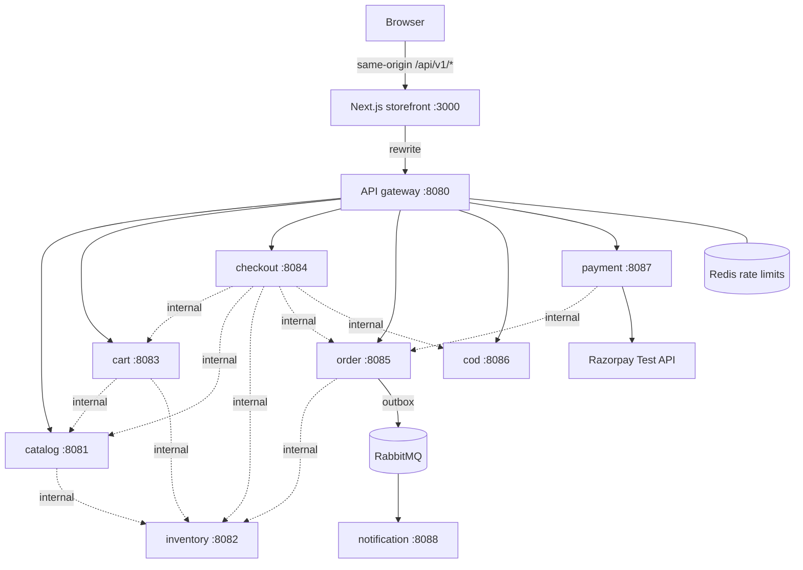

# Era Wovens — Ethnic Fashion E-Commerce (preview)

> **Status: M0–M3 working slice, not production-ready.** The storefront, catalogue, cart, bulk orders, checkout, COD and a Razorpay **Test Mode** payment flow run end-to-end locally. Accounts/admin are not built yet (see [Known limitations](#known-limitations)). The payment service **refuses to start with live keys**. The full original specification is kept in [`docs/SPECIFICATION.md`](docs/SPECIFICATION.md).

An original, premium storefront for sarees and ethnic wear (ivory / champagne gold / plum identity), with a Java microservice backend. Product imagery is **original procedural SVG artwork** generated from each product's motif and colourway — no third-party photos, copy or branding.

## What is implemented

| Area | Implemented in this milestone |
|---|---|
| Storefront (`apps/storefront`) | Next.js 16 + React 19 + Tailwind 4. Home, collections, bulk orders, search, product detail, quick view, wishlist (device-local), cart (regular + bulk tabs), checkout, order confirmation / test payment, my orders, order tracking, about, contact, FAQ, policy drafts, 404/error/loading states. Mega-menu, mobile drawer, filter drawer, sticky mobile add-to-bag. Nonce-based CSP. |
| `api-gateway` | Spring Cloud Gateway: only public entry point, routing allowlist, Redis rate limits (stricter on checkout/payments/order lookup), exact-origin CSRF check, HttpOnly guest-session cookie (forwarded only as SHA-256), strips spoofable headers, request IDs, security headers, 512 KB body limit. |
| `catalog-service` | Collections, products, colour variants; filters (colour, fabric, price, in-stock), sort, pagination, PostgreSQL full-text search; authoritative SKU price lookup (internal). |
| `inventory-service` | Stock levels, all-or-nothing reservations with TTL, commit/release, expiry sweeper, append-only movement audit. Atomic conditional updates — concurrency-tested to never oversell. |
| `cart-service` | Guest carts keyed by session hash; separate REGULAR and BULK carts; per-line limits, stock checks, bulk minimum (10 units, mixed SKUs configurable); IDOR-safe item ownership. |
| `checkout-service` | Server-side pricing (integer paise): GST-inclusive tax component, coupons, shipping rules, COD fee; HMAC-signed, expiring quotes; re-pricing immediately before order placement; idempotent order placement (`Idempotency-Key`), compensation on failure. |
| `order-service` | Explicit state machine, immutable item/price snapshots (DB triggers), status history, transactional outbox → RabbitMQ, payment-window expiry, ownership-checked reads, order lookup by number + email. |
| `cod-service` | COD eligibility (PIN code, order-value cap incl. fee, bulk exclusion, pending-order and RTO abuse limits), idempotent confirmation, collection/RTO reconciliation with actor audit. Phone numbers stored only as HMAC. |
| `payment-service` | Razorpay **Test Mode only**: server-created provider orders (only the public `rzp_test_` key reaches the browser), checkout signature verification (constant-time HMAC), authoritative payment fetch, webhook HMAC over the raw body with a separate secret, event-id dedupe, amount/currency/ownership checks. |
| `notification-service` | RabbitMQ consumer with DLQ and inbox dedupe; email adapter logs a masked "would send" line (no provider wired yet). |

## Architecture



* Every service owns its own PostgreSQL database **and login role**; no service can read another's tables.
* Services accept only callers presenting an internal token: `ROLE_GATEWAY` for `/api/**`, `ROLE_SERVICE` for `/internal/**`, everything else denied. (Interim until mTLS/workload identity — see threat model.)
* `libs/service-platform` holds only cross-cutting servlet concerns (security filter, request IDs, error mapping). No shared entities.

## Run it locally

Prerequisites: JDK 21, Maven 3.9, Node 22 + pnpm 10, Docker.

```bash
scripts/dev-env.sh                 # creates .env with random local secrets (never committed)
scripts/run-local.sh               # Postgres/Redis/RabbitMQ in Docker, 9 services, storefront on :3000
open http://localhost:3000
scripts/run-local.sh stop          # stop services (docker compose -f infra/compose.yaml down to stop infra)
```

Demo coupons: `WELCOME10` (10% off retail ≥ ₹2,000, max ₹1,000), `FESTIVE500` (₹500 off ≥ ₹5,000), `BULK5` (5% off bulk ≥ ₹15,000).

**Online payments (optional):** add your Razorpay **test** keys to `.env` (`RAZORPAY_KEY_ID=rzp_test_…`, `RAZORPAY_KEY_SECRET`, `RAZORPAY_WEBHOOK_SECRET`), set `RAZORPAY_ENABLED=true`, restart. Point a Razorpay test webhook (`payment.captured`, `order.paid`, `payment.failed`) at `https://<public-host>/api/v1/webhooks/razorpay`. Without keys the storefront shows online payment as unavailable and COD works.

## Tests

| Suite | Command | Result (this commit) |
|---|---|---|
| Backend unit + integration (Testcontainers Postgres/RabbitMQ) | `mvn verify` | **53 passed, 0 failed** across 10 modules |
| Storefront type check / production build | `pnpm typecheck && pnpm build` | pass |
| E2E (Playwright, live local stack, desktop + mobile) | `cd apps/storefront && pnpm test:e2e` | **6 passed** |
| Dependency audit | `pnpm audit --audit-level high` | no known vulnerabilities |

Notable cases covered: 25 concurrent buyers for 5 units → exactly 5 reservations; all-or-nothing reservation rollback; reservation expiry; idempotent order creation and checkout replay; idempotency-key reuse with a different body rejected; tampered order snapshots rejected; illegal state transitions rejected; immutable snapshots; late capture after expiry → review; forged checkout signature, wrong-secret webhook, re-serialised webhook body, wrong amount — all rejected; duplicate webhook processed once; live keys / non-test mode refused at startup; COD limits and reconciliation; duplicate broker deliveries send one email; CSRF from foreign origin blocked; spoofed internal headers stripped; GST/discount allocation sums exactly.

Manually verified through the gateway: COD order placed, stock committed, cart emptied, confirmation event delivered; other sessions get 404 for the order; `/internal/**` not routable; services reject calls without the internal token (401); unknown JSON fields rejected.

Not yet verified: a real Razorpay test-mode transaction (needs your test keys), OWASP ZAP, load testing, Lighthouse scores.

## Known limitations

* **Not built yet:** `auth-service` (accounts, login, MFA, RBAC), `admin-service` / admin UI, cart merge-on-login, refunds orchestration, shipping/carrier integration, real email/SMS provider. Customers check out as guests; "My orders" is per browser.
* Service-to-service auth uses shared tokens (gateway vs service), not mTLS/workload identity.
* Catalogue filtering loads up to 500 candidate products and refines in memory (fine for this catalogue; move stock projection/OpenSearch before scaling).
* Coupon uses are not returned when an unpaid online order expires.
* GST rates (5% ≤ ₹2,500/piece, 18% above) and all policy pages are **drafts** to be confirmed by qualified advisers. Contact details are placeholders.
* No OpenAPI spec generated yet; see [`docs/api-contracts.md`](docs/api-contracts.md).
* Storefront CSP allows inline styles (`style-src 'unsafe-inline'`); scripts are nonce-restricted.

## Repository layout

```
apps/storefront/          Next.js customer site (+ e2e/ Playwright tests)
services/<name>/          Spring Boot 3.5 services (controller/ application/ domain/ infrastructure/ config/, db/migration)
libs/service-platform/    Shared servlet security + error handling (no domain code)
packages/design-tokens/   Colour/type/motion tokens
infra/                    Docker Compose for Postgres, Redis, RabbitMQ; per-service DB bootstrap; seed catalogue
scripts/                  dev-env, run-local, seed generator
docs/                     Specification, threat model, API contracts, decisions, runbooks
```
