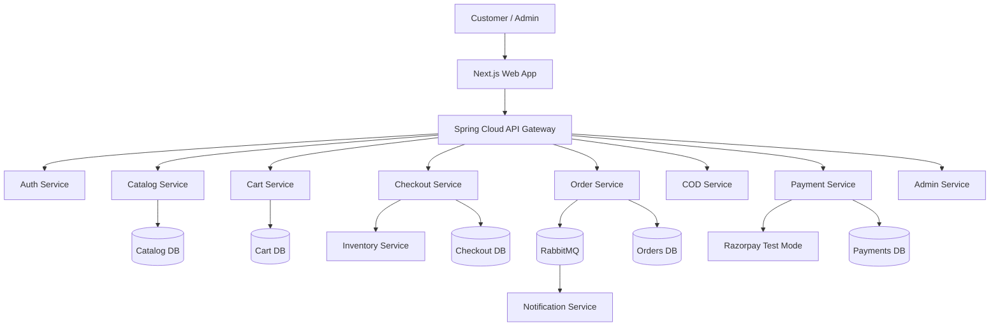

# AURELIA — Premium Ethnic Fashion E-Commerce

> **Project status:** Architecture and implementation specification. This repository is not yet a completed application. All payments must remain in Razorpay **Test Mode** until a separately approved production launch.

## 1. Product vision
Build a beautiful, fast, accessible, mobile-first Indian ethnic-fashion storefront with an original premium visual identity. Use https://www.rathisilks.com/collections/bulk-order as **functional inspiration only**: catalogue browsing, colour/price/availability filters, sorting, product details, bulk orders, and cart/checkout. Do not copy its brand, photographs, product descriptions, trademarks, or source code.

**Initial business assumptions (configurable):** INR currency, India shipping, sarees and ethnic apparel, a dedicated bulk-order collection with minimum 10 eligible items, and bulk carts kept separate from regular carts. Allow different SKUs to satisfy the bulk minimum if configured. COD is a separate order-payment method, subject to admin-configured postcode, cart-value and fraud eligibility. Tax, shipping, discount, COD charges, and inventory are always computed on the server.

### Design direction
- Original luxury identity: warm ivory `#F8F5EF`, champagne gold `#C5A46D`, deep plum `#352433`, charcoal `#242124`, muted rose `#D7B6AE`; contrast-safe accessible alternatives.
- Editorial serif headings paired with a legible contemporary sans-serif; generous whitespace, crisp product photography, restrained motion, tactile hover states, subtle gradients and shadows.
- Desktop: elegant mega-menu, immersive hero, editorial collections, 3–4-column catalogue; mobile: fast two-column catalogue, filter drawer, sticky add-to-cart, thumb-friendly navigation.
- Product cards: image variants, hover zoom, badges, price, fabric, available colours, quick view and wishlist; never imply fake scarcity or fabricate reviews.
- Accessibility: WCAG 2.2 AA target, keyboard navigation, visible focus, semantic landmarks, alt text, reduced-motion support, accessible errors.
- Performance: target Lighthouse 90+ for performance/accessibility/best practices/SEO on representative pages; Core Web Vitals targets LCP <=2.5s, INP <=200ms, CLS <=0.1 at the 75th percentile.

## 2. Technology stack
| Layer | Choice |
|---|---|
| Storefront and admin | Next.js (React + TypeScript), Tailwind CSS, accessible component primitives |
| Backend | Java 21 LTS, Spring Boot 3.x compatible supported releases, Spring Security, Spring Validation |
| Gateway | Spring Cloud Gateway with compatible BOM; TLS termination at trusted edge |
| Identity | Dedicated auth service using Spring Security, OAuth2/OIDC patterns, short-lived access tokens and secure refresh sessions |
| Persistence | PostgreSQL, **one database/schema owner per service**, Flyway migrations |
| Cache / throttling | Redis, distributed rate limits and short-lived reservations |
| Messaging | RabbitMQ with outbox pattern, durable queues, retries and dead-letter queues |
| Search | PostgreSQL full-text initially; optional OpenSearch at scale |
| Object storage | S3-compatible storage for product media; signed uploads and CDN |
| Payments | Razorpay Java server integration **Test Mode only** |
| Observability | OpenTelemetry, Prometheus, Grafana, structured logs with PII redaction |
| Infrastructure | Docker Compose locally; managed container platform/Kubernetes later |
| Testing | JUnit 5, Mockito, Testcontainers, REST Assured, Playwright, OWASP ZAP |
| CI/CD | GitHub Actions, dependency and container scans, protected environments |

Use a pinned, mutually compatible dependency set and renovate/update routinely; verify currently supported versions before implementation. Do not enable experimental features in production.

## 3. Service boundaries
Each independently deployable backend component is a Java Spring Boot service. **Never share database tables across services.**

| Service | Ownership / core responsibilities |
|---|---|
| `api-gateway` | Routing, authentication enforcement, coarse rate limiting, request IDs, safe CORS |
| `auth-service` | Signup/login, email verification, password reset, sessions, MFA for admins, RBAC |
| `catalog-service` | Collections, product metadata, images, variants, filters, pricing display |
| `inventory-service` | Available stock, reservation, expiry, release, stock movement audit |
| `cart-service` | Guest/authenticated carts, quantity changes, merge-on-login, cart expiry |
| `checkout-service` | Server-side totals, addresses, coupons, shipping, tax, stock validation, checkout state |
| `order-service` | Order lifecycle, order snapshots, fulfilment status, cancellations, refunds coordination |
| `cod-service` | COD eligibility, COD confirmation, cash-collection reconciliation, RTO controls |
| `payment-service` | Razorpay test orders, signature/webhook verification, reconciliation, refunds orchestration |
| `notification-service` | Transactional email/SMS templates, retries, opt-in marketing |
| `admin-service` | Admin BFF, roles, product/order management, audit records; delegates domain writes to owner services |

An additional shipping service may be introduced when carrier integrations justify it. `admin-service` must not bypass the other services' authorization and business invariants.

### Architecture

All other stateful services have their own stores. The gateway is the only public backend entry point; internal services are private. Use authenticated service-to-service communication and network segmentation.

## 4. Suggested repository structure
```text
premium-commerce/
├── README.md
├── apps/
│   ├── storefront/                 # Next.js customer website
│   └── admin-web/                  # Separate admin frontend
├── services/
│   ├── api-gateway/
│   ├── auth-service/
│   ├── catalog-service/
│   ├── inventory-service/
│   ├── cart-service/
│   ├── checkout-service/
│   ├── order-service/
│   ├── cod-service/
│   ├── payment-service/
│   ├── notification-service/
│   └── admin-service/
├── packages/
│   ├── api-contracts/              # OpenAPI specs and generated clients
│   └── design-tokens/
├── infra/
│   ├── compose.yaml
│   ├── observability/
│   └── deployment/
├── docs/
│   ├── architecture/
│   ├── threat-model.md
│   ├── api-contracts.md
│   ├── runbooks/
│   └── decisions/
├── tests/
│   ├── e2e/
│   ├── contract/
│   ├── performance/
│   └── security/
├── .github/workflows/
├── .env.example
└── .gitignore
```
Within each Java service use `controller/`, `application/`, `domain/`, `infrastructure/`, `config/`, `security/`, `src/test/`, and versioned `db/migration/`. Avoid distributing a shared JPA entity library across services.

## 5. Pages and user experience
**Public:** Home, collections, bulk orders, search, product detail, wishlist, cart, checkout, payment result, order tracking, login/register, account, address book, order history, contact, about, FAQ, privacy policy, terms, shipping, returns/refunds.

**Admin:** MFA-protected dashboard, product/variant/image management, inventory, collections, bulk rules, discounts, orders, COD eligibility, payment/refund status, customer support, RBAC, and immutable audit log.

**Essential states:** skeleton loading, empty cart, no results, out of stock, invalid coupon, failed payment, timeout, session expiry, insufficient inventory, accessibility errors, graceful offline/network recovery. Include optimistic UI only where server confirmation cannot create false success.

## 6. Business invariants and money safety
1. Represent monetary amounts as integer minor units (paise) or exact `BigDecimal` with explicit rounding; never JavaScript floating-point arithmetic for final prices.
2. The backend owns prices, discount eligibility, taxes, shipping, COD fees, final totals and currency. Ignore client-submitted totals.
3. Lock/version inventory reservations to prevent overselling; reservations expire and release automatically.
4. Require idempotency keys for checkout/order/payment operations and use unique database constraints to prevent duplicate charges/orders.
5. Use an explicit order state machine: `DRAFT -> PENDING_PAYMENT | COD_CONFIRMED -> CONFIRMED -> FULFILLING -> SHIPPED -> DELIVERED`; separate terminal failure/cancel/return/refund paths. Enforce legal transitions.
6. Persist immutable order item/price/tax/shipping snapshots. Do not derive historic totals from current catalogue prices.
7. Use outbox/inbox deduplication for cross-service events. No distributed database transaction assumption.
8. Recalculate cart and eligibility when checkout begins and immediately before order finalization.
9. Bulk minimum, regular/bulk separation, COD eligibility, stock, and discounts must be validated server-side and tested.

## 7. Customer flows
### Cart
- Guest cart uses a random opaque identifier in a secure, HttpOnly cookie; authenticated cart belongs to verified user ID.
- `POST /api/v1/cart/items`, `PATCH /api/v1/cart/items/{itemId}`, `DELETE /api/v1/cart/items/{itemId}`, `GET /api/v1/cart`.
- Validate SKU/variant, maximum quantity, stock and bulk rules; cart stores a pricing preview, not authoritative checkout totals.
- Merge carts deterministically on login; do not silently exceed inventory or mix bulk/regular order types.

### Checkout
1. Authenticate or support guest checkout with verified contact details.
2. Validate address, deliverable postcode, items, quantity, discounts and tax.
3. Calculate shipping and payable amount on server; return signed/versioned quote with expiry.
4. Reserve stock and create pending order/checkout with unique idempotency key.
5. Customer chooses **COD** or **Online (Razorpay Test)**; mutually exclusive payment attempts for one order.
6. On final confirmation, persist order state and emit reliable events. Display confirmation only after server-authoritative state is established.

### COD microservice
- `POST /api/v1/cod/eligibility` (read-only calculation); `POST /api/v1/cod/confirm` (authenticated, idempotent, internal checkout orchestration).
- Validate serviceable PIN codes, order value limits, prohibited items, abuse controls and optional COD surcharge.
- No Razorpay request for COD. Mark `payment_method=COD`, `payment_status=PENDING_COLLECTION`, `order_status=COD_CONFIRMED`.
- Record collection on delivery with authorized staff workflow and audit history; support RTO, cancellations, reconciliation, and fraud review.

### Online payment microservice — Razorpay sandbox
1. Payment service reads the **server-owned** pending order amount/currency and creates a Razorpay **test order** using server-side test credentials.
2. Return only the public test `key_id`, Razorpay order ID and display details to the frontend; **never return `key_secret`**.
3. Launch official Razorpay Checkout using test mode. Display an obvious `TEST PAYMENT — NO REAL MONEY` notice.
4. After the checkout callback, send payment ID, order ID and signature to the backend. Verify the signature server-side using Razorpay's documented HMAC mechanism and constant-time comparison.
5. Validate expected Razorpay order ID, amount, currency, ownership and payment status; fetch authoritative status from Razorpay as needed. Never mark paid based solely on frontend callback.
6. Webhook endpoint validates `X-Razorpay-Signature` over the **raw request body**, uses a separate webhook secret, deduplicates event IDs, tolerates retries/out-of-order events and updates the payment state idempotently.
7. Confirm the order only after trusted captured/successful payment evidence. For failure/cancel/expiry, allow safe retry or release reservations after TTL.
8. Persist provider transaction IDs, non-sensitive metadata and reconciliation status. Never store full card numbers/CVV or sensitive bank credentials.
9. Test success, failure, abandonment, delayed webhooks, duplicate events, replay attempts, invalid signatures, wrong amounts, and concurrency.
10. Production keys must not be enabled without a separate approved go-live checklist, KYC, compliance review and environment isolation.

Official documentation: https://razorpay.com/docs/payments/ and https://razorpay.com/docs/webhooks/ . Test mode simulates payments without moving real money.

## 8. Example API contract (illustrative; finalize in OpenAPI)
```text
GET    /api/v1/catalog/products?collection=bulk&color=maroon&sort=price_asc
GET    /api/v1/catalog/products/{slug}
GET    /api/v1/cart
POST   /api/v1/cart/items
PATCH  /api/v1/cart/items/{itemId}
DELETE /api/v1/cart/items/{itemId}
POST   /api/v1/checkout/quotes
POST   /api/v1/checkout/sessions
POST   /api/v1/checkout/{id}/confirm-cod
POST   /api/v1/payments/razorpay/orders
POST   /api/v1/payments/razorpay/verify
POST   /api/v1/webhooks/razorpay
GET    /api/v1/orders/{id}
GET    /api/v1/me/orders
```
All resource reads/writes enforce ownership at the service layer. Admin APIs live under `/api/v1/admin/**` with explicit privileges; never trust a client-provided role, user ID or price.

## 9. Security requirements — mandatory release gates
Security must be designed and tested; **no software can be guaranteed unhackable**. Track residual risks and require independent review before production.

### Secrets and configuration
- [ ] Never hardcode API keys, passwords, JWT signing keys, database URLs with credentials or webhook secrets.
- [ ] Use `.env.example` with placeholder names only; real `.env*`, credentials and private keys are gitignored and excluded from Docker build contexts.
- [ ] Validate required environment variables at startup and fail closed if missing/invalid.
- [ ] Use cloud secret manager or protected CI secrets, least-privilege IAM and regular rotation.
- [ ] Run Gitleaks (including git history), detect leaked secrets and rotate any exposed credential immediately.
- [ ] Keep test and production keys, databases and environments isolated.

### Identity and access
- [ ] Spring Security default-deny; explicit route and method authorization, including object-level authorization (IDOR/BOLA prevention).
- [ ] Hash passwords with adaptive Argon2id or suitably configured bcrypt; never encrypt or log raw passwords.
- [ ] Email verification, secure password reset, login throttling, account lockout/backoff, admin MFA.
- [ ] Short-lived access tokens; secure rotating refresh tokens or server-side sessions with revocation and reuse detection.
- [ ] Prefer HttpOnly, Secure, SameSite cookies and CSRF protection for cookie-authenticated state changes; do not store auth tokens in localStorage.
- [ ] Separate CUSTOMER, SUPPORT, INVENTORY_MANAGER, ORDER_MANAGER and ADMIN privileges with least privilege.
- [ ] Recheck authorization on every admin action and log sensitive changes.

### Input, web and API security
- [ ] Bean Validation with field allowlists, strict DTO mapping, bounds and schema validation; parameterized SQL/ORM queries.
- [ ] React escaping by default; sanitize rich text with maintained allowlist sanitizer; prohibit unsafe HTML injection.
- [ ] Defend against XSS, CSRF, SQL injection, SSRF, open redirects, path traversal, unsafe file uploads and mass assignment.
- [ ] Rate limits by IP, account and route, especially login, OTP, coupons, checkout and payment creation; use Redis-backed distributed controls.
- [ ] Restrict CORS to exact trusted origins, methods and headers; never use wildcard origins with credentials.
- [ ] Enforce HTTPS/TLS, HSTS, CSP (nonce/hash based), `X-Content-Type-Options: nosniff`, `Referrer-Policy`, `Permissions-Policy`, safe frame restrictions and secure cookies.
- [ ] Disable debug mode, stack traces and public Spring Actuator endpoints in production; limit health endpoints to non-sensitive information.
- [ ] Enforce request body limits, upload type/content checks, malware scanning, safe filenames, signed media access and object-store permissions.
- [ ] Validate payment signatures/webhook HMAC and prevent replay, spoofed success and amount tampering.
- [ ] Do not leak PII, tokens, secrets or payment data in logs, analytics, error pages or traces.

### Infrastructure and database
- [ ] One DB identity per service, minimum permissions, private networking, TLS connections and encrypted storage/backups.
- [ ] Non-root, minimal container images, read-only filesystem where practical, pinned image digests, no unnecessary exposed ports.
- [ ] Database migrations reviewed and reversible where possible; backups encrypted and restore-tested.
- [ ] Internal APIs authenticated (mTLS or workload identity); network policies restrict lateral movement.
- [ ] Dependency locking, SCA, SBOM, Dependabot/Renovate, container scanning and unused dependency removal.
- [ ] Signed build artifacts and protected CI/CD environments; no secrets printed in CI logs.
- [ ] Centralized audit logs, monitoring, alerting, incident response and vulnerability disclosure process.

### Security testing and audit
- [ ] Threat model with trust boundaries, payment abuse, admin takeover, credential stuffing and checkout manipulation.
- [ ] SAST (CodeQL/Semgrep), SCA (OWASP Dependency-Check/OSV), secrets (Gitleaks), container scan (Trivy), IaC checks.
- [ ] DAST (OWASP ZAP) against authorized staging; manual OWASP ASVS / API Security Top 10 review.
- [ ] Negative tests for broken object authorization, role escalation, XSS, CSRF, SQLi, race conditions, webhook forgery and replay.
- [ ] Independent penetration test before real payments, remediation tracking and retest.
- [ ] Block release for unresolved critical/high exploitable vulnerabilities; document any formally approved exception.

## 10. Data model sketch
- `users`, `user_roles`, `sessions`, `addresses` (auth/account owner)
- `products`, `variants`, `collections`, `product_images`, `price_rules` (catalog owner)
- `stock_levels`, `stock_reservations`, `stock_movements` (inventory owner)
- `carts`, `cart_items` (cart owner)
- `checkout_sessions`, `quotes`, `coupon_redemptions` (checkout owner)
- `orders`, `order_items`, `order_events`, `fulfilments` (order owner)
- `cod_eligibility_rules`, `cod_confirmations`, `cod_collections` (COD owner)
- `payment_attempts`, `provider_orders`, `webhook_receipts`, `refunds` (payment owner)

Use UUID/ULID identifiers, appropriate unique indexes, optimistic locking, timestamps, retention policies and audit events. Avoid duplicating sensitive customer data across services; minimize and encrypt PII.

## 11. Local development plan
**Prerequisites:** JDK 21, Node.js supported LTS, pnpm, Docker + Compose, Git and a Razorpay account with **test** keys.

1. Create the repository structure, `.env.example`, `.gitignore`, formatting rules, OpenAPI specs and CI security workflow.
2. Provision local PostgreSQL databases, Redis, RabbitMQ and observability via Compose; expose only required local ports.
3. Implement auth, catalogue, inventory and cart first; seed original licensed placeholder product images/data.
4. Build Next.js storefront pages with mock API adapters, then connect to live local services.
5. Implement checkout quote and stock reservation with idempotency and concurrency tests.
6. Implement COD as an independently deployable service and test COD reconciliation.
7. Implement Razorpay **Test Mode** payment service and signed webhooks; use protected test credentials.
8. Implement order management, notifications, admin RBAC and full audit logs.
9. Run automated tests, security scans, accessibility checks, performance tests and manual QA.
10. Deploy staging with test-only payment keys; do not deploy a real-money checkout until the go-live gates are met.

Example `.env.example` (**placeholders only; never commit real values**):
```dotenv
APP_ENV=development
PUBLIC_APP_URL=http://localhost:3000
DATABASE_HOST=localhost
DATABASE_PORT=5432
REDIS_HOST=localhost
RABBITMQ_HOST=localhost
RAZORPAY_MODE=test
RAZORPAY_KEY_ID=replace_with_test_key_id
RAZORPAY_KEY_SECRET=replace_with_secret_from_secret_manager
RAZORPAY_WEBHOOK_SECRET=replace_with_webhook_secret
```
Real credentials should be supplied to services via a secret manager or protected local environment; do not expose `RAZORPAY_KEY_SECRET` or `RAZORPAY_WEBHOOK_SECRET` through `NEXT_PUBLIC_*` variables. The browser may receive the Razorpay **public test key ID** only.

**Note:** These are implementation instructions, not a claim that `docker compose up` or any service works yet. Add verified run commands after creating the corresponding source files.

## 12. Test matrix and acceptance criteria
| Area | Minimum acceptance criteria |
|---|---|
| Catalogue | Search, filters, sort, pagination, variants, accessibility and responsive states work |
| Cart | Add/update/remove, guest persistence, merge, inventory limits and bulk minimum work |
| Checkout | Server-side totals, taxes, delivery and coupons validated; tampered totals rejected |
| COD | Eligibility enforced, order confirmed once, cash pending and reconciliation supported |
| Razorpay | Test success/failure, verified signature, trusted status, duplicate webhook safety, no real charge |
| Orders | Correct ownership, state transitions, retries, cancellation and history |
| Admin | MFA, least-privilege roles, no unauthenticated or cross-role access, audit trail |
| Security | CI scans pass, high/critical issues resolved, threat-model checks and staging DAST pass |
| UX | Mobile-first, keyboard-accessible, WCAG 2.2 AA target, no broken states |
| Reliability | Concurrent checkout cannot oversell or create duplicate paid orders |

**Suggested testing layers:** unit tests per service; Testcontainers integration tests; consumer-driven contract tests; Playwright E2E across desktop/mobile; payment/COD state-machine tests; k6 load tests; security tests; manual exploratory QA. Cover all critical business paths before production.

## 13. Milestones
- **M0 — Foundation:** Design system, architecture decisions, threat model, repository, CI, Docker infrastructure.
- **M1 — Storefront:** Responsive pages, product browsing, search, filtering, detail pages, admin product management.
- **M2 — Shopping:** Auth, cart, inventory, bulk minimum rules, coupon/quote and checkout UI.
- **M3 — Payments:** Independent COD and Razorpay Test Mode services, order lifecycle and webhook reconciliation.
- **M4 — Operational readiness:** Admin permissions, notifications, returns/refunds workflow, accessibility/performance tuning.
- **M5 — Security and staging:** E2E, load, security audit, incident runbooks and controlled staging demonstration.
- **M6 — Optional production launch:** Separate approval for real payments, Razorpay live onboarding, legal/tax/shipping policy validation, pen test, backup restore and monitoring.

## 14. Definition of done
A feature is complete only when it has working UI and backend integration, validated inputs, authorization, error/empty/loading states, documented APIs, migrations, tests, observability, and no unresolved release-blocking security findings. **Do not mark this project production-ready merely because the UI renders or a sandbox payment succeeds.**

## 15. Legal, privacy and brand considerations
Use only licensed/original product images, copy and design assets. Provide real contact information and accurate shipping, return, privacy, cookie and terms disclosures. Determine applicable Indian consumer protection, GST/invoicing, data protection and payment compliance with qualified advisers before production. Minimize personal data and define retention/deletion policies.

## 16. Implementation guidance for coding agents
- Implement milestone by milestone; never replace functional code with placeholders without explicit disclosure.
- Produce runnable, tested code and migration scripts for each service; keep architecture and OpenAPI docs synchronized.
- Do not fake a successful payment, order or security audit. Label simulated data and sandbox transactions clearly.
- Never bypass authentication, authorization, signature verification or inventory checks to make demos work.
- Preserve a polished consistent design across every route and device size.
- Provide a short test report and list of known limitations with each milestone.

---
**Reference:** https://www.rathisilks.com/collections/bulk-order (inspiration only). **Payments:** https://razorpay.com/docs/payments/ and https://razorpay.com/docs/webhooks/ .
